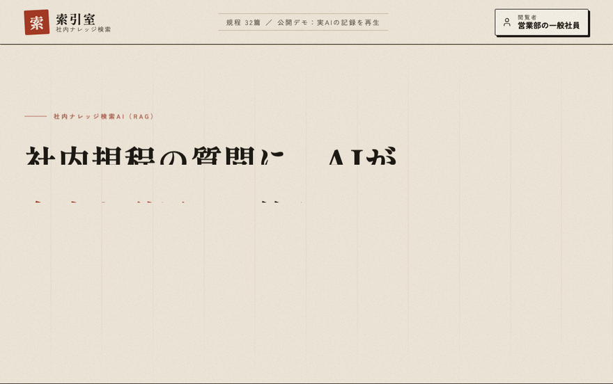
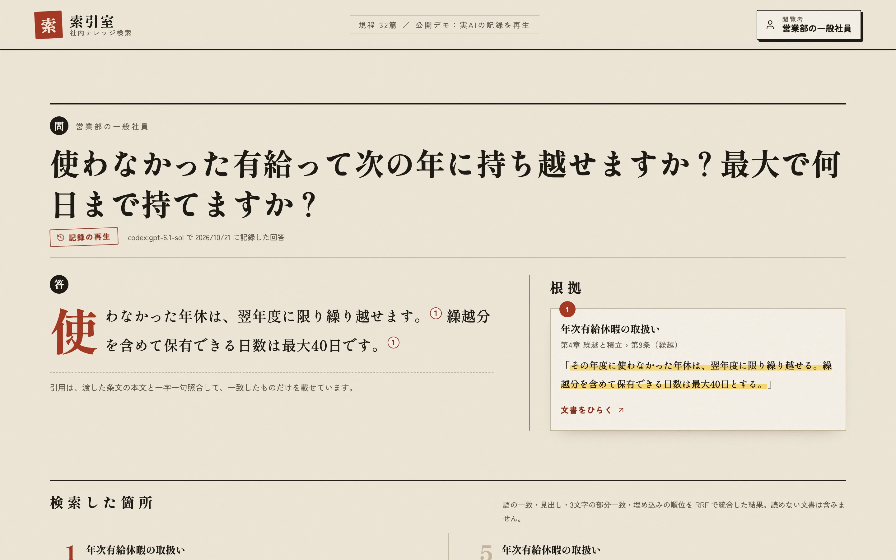
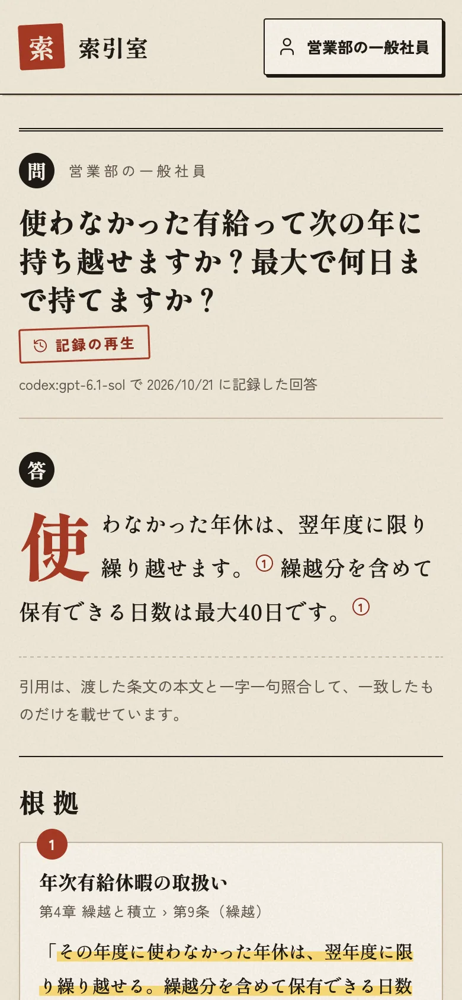
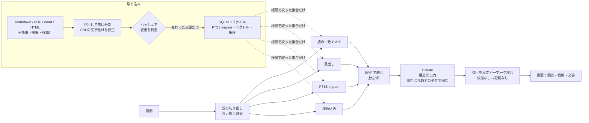

# 索引室 — 社内規程の質問に、条文を引用して答える社内ナレッジ検索AI（RAG）

**就業規則・経費精算・情報セキュリティなどの社内規程（Markdown・PDF・Word・HTML）を取り込み、日本語に強いハイブリッド検索で該当の条文を引いて、Claude が引用つきで答える業務システム。書かれていないことには「規程に記載がありません」と答え、部署・役職ごとに読める文書を検索の段階で分けます。**

[](https://github.com/Ryou-Koshimizu/japanese-knowledge-rag/actions/workflows/ci.yml)
[](LICENSE)



上は公開デモの実画面です。検索はその場で実行し、回答は実AI（gpt-6.1-sol）で事前に記録した回答を再生しています（画面に「記録の再生」と表示）。

<p>
  
  
</p>

## 何ができるか

- **4種類の文書を、見出しの構造ごと取り込む**：Markdown（フロントマター）、PDF（「第N章」「第N条」「1.1」を見出しとして認識、PDF 特有の文字化け〔康熙部首〕も直す）、Word（見出しスタイル・表）、HTML（ナビゲーションやスクリプトを除く）。条・節の単位で分割する
- **差分取り込み**：中身と権限の情報のハッシュを比べ、変わった文書だけを分割・埋め込みし直す。消えた文書は索引からも消し、壊れたファイルで既存の索引を失わない
- **日本語に強いハイブリッド検索**：辞書なしで語を切り出し（文字の種類の切れ目で区切る）、「語の一致（BM25）」「見出し」「SQLite FTS5 trigram の部分一致」「埋め込み」の4つの順位を RRF で統合。社内用語の言い換え辞書（育休→育児休業 など）で語を広げる
- **出典つきの回答と、捏造の遮断**：AIの引用は条文の本文と一字一句照合し、合わない引用は表示しない。根拠が残らない回答は「規程に記載がありません。」に置き換える
- **プロンプトインジェクション対策**：文書は毎回ちがう名前のタグで囲んだデータとして渡し、文書の中の命令に従わない。根拠にない URL は回答から消す
- **部署・役職ごとの権限**：検索のすべての SQL に権限の条件を入れ、読めない文書は検索結果・AIへの入力・文書の閲覧のどこにも出さない
- **差し替えられる境界**：埋め込み（軽量／手元の多言語モデル／Voyage／OpenAI）、回答AI（Claude／測定用 Codex／記録の再生）、認証（閲覧者の選択／トークン）を環境変数で選ぶ

## 実測

<!-- summary:start -->
| 指標 | 結果 | 条件 |
| --- | --- | --- |
| **回答の正答（実AI）** | **105/105 問** | gpt-6.1-sol（ChatGPT の Codex CLI 経由）。答えがある・書かれていない・読めない・乗っ取りの5種類 |
| 誤った引用 | 0 件 | 表示した引用 116 件。すべて本文と一字一句一致 |
| 「記載なし」の正答 | 28/28 問 | 書かれていない13・読めない11・質問からの乗っ取り4 |
| 検索 Recall@5 / MRR | 0.961 / 0.855 | 77問、4方式の統合・多言語の文埋め込み。軽量な埋め込み（公開デモ）では 0.948 / 0.752 |
| 検索 Recall@10 | 1.000 | 同上 |
| 権限の漏れ | 0 件 | 630回の検索・6,300件の結果を権限の定義と照合 |
| 1問あたりの回答時間 | 中央値 5.98 秒 | 検索は十数ミリ秒、残りは AI |
| 実AI×実ブラウザの通し確認 | 14/14 件 | Chromium と WebKit で画面から7種類の質問を入力し、回答・根拠・文書の表示まで確認 |
<!-- summary:end -->

測定の詳細は [検証記録](docs/verification.md)、生の記録は [docs/evidence](docs/evidence)。

## 試す

### ブラウザで（インストール不要）

公開デモは Vercel の Python ランタイムで動く構成です（[vercel.json](vercel.json)・[api/index.py](api/index.py)、鍵なし）。閲覧者（営業部の一般社員・経理部の管理職・役員など6人）を切り替えると、読める文書と答えが変わります。

### 手元で（鍵なし・uv で2コマンド）

```sh
uv sync
uv run knowledge-rag serve        # http://127.0.0.1:8104
```

Python 3.12 以上（uv が用意します）。公開デモと同じ「記録の再生」で動き、AI の鍵は要りません。検索だけをコマンドで試すこともできます。

```sh
uv run knowledge-rag search "育休は何歳まで？" --persona sales-staff
```

### 自分の規程で（実AI）

```sh
cp -r corpus my-corpus                       # 文書を入れ替える（権限はフロントマター／.meta.yaml）
export ANTHROPIC_API_KEY=...                 # Claude API の鍵
RAG_MODE=live RAG_CORPUS_DIR=my-corpus uv run knowledge-rag serve
```

| 環境変数 | 意味 | 既定 |
| --- | --- | --- |
| `RAG_MODE` | `demo`（記録の再生）／`live`（実AI） | `demo` |
| `RAG_ANSWER_MODEL` | 回答に使う Claude のモデル | `claude-sonnet-5-5` |
| `RAG_EMBEDDER` | `hashing`（依存なし）／`local`（`uv sync --extra local`、多言語の文埋め込み）／`voyage`／`openai` | `hashing` |
| `RAG_AUTH` | `demo`（閲覧者を選ぶ）／`token`（利用者ごとのトークン。`_users.yaml` に SHA-256 を書く） | `demo` |
| `RAG_DB_PATH` | 索引の SQLite ファイル | live は `data/index.db` |
| `RAG_ASK_PER_MINUTE` | 実AIモードの1人あたりの回数制限 | `20` |

文書を差し替えたら、`uv run knowledge-rag ingest --corpus my-corpus` で変わった文書だけを取り込み直します（起動時にも自動で差分を取り込みます）。

## 構成



| 層 | 実装 |
| --- | --- |
| 取り込み | [loaders.py](src/knowledge_rag/loaders.py)・[chunker.py](src/knowledge_rag/chunker.py)・[ingest.py](src/knowledge_rag/ingest.py) |
| 保存と権限 | [store.py](src/knowledge_rag/store.py)：FTS5 trigram、ベクトル、権限の条件をすべての検索 SQL に |
| 検索 | [search.py](src/knowledge_rag/search.py)・[text.py](src/knowledge_rag/text.py) |
| 回答と照合 | [prompt.py](src/knowledge_rag/prompt.py)・[providers.py](src/knowledge_rag/providers.py)・[answer.py](src/knowledge_rag/answer.py) |
| API と画面 | [app.py](src/knowledge_rag/app.py)（FastAPI）・[web/](src/knowledge_rag/web)（素の HTML/CSS/JS、外部スクリプトなし） |
| 評価 | [evaluation.py](src/knowledge_rag/evaluation.py)・[scripts/evaluate.py](scripts/evaluate.py) |

判断の記録：[SQLite 1ファイル](docs/adr/001-sqlite-single-file.md) / [日本語のハイブリッド検索](docs/adr/002-japanese-hybrid-search.md) / [差し替えられる境界](docs/adr/003-swappable-boundaries.md) / [引用の照合と乗っ取り対策](docs/adr/004-grounding-and-injection.md) / [権限は検索の段階で](docs/adr/005-access-control-at-retrieval.md) / [公開デモは記録の再生](docs/adr/006-public-demo-replay.md) / [要件定義](docs/requirements.md)

## 権限とセキュリティ

- 文書ごとに「読める部署（`*` は全社）」と「読める最低の役職」を持ち、4つの検索方式すべての SQL に同じ条件を入れる。読めない文書は「存在しない」と同じ 404
- 評価セットの全質問 × 6人で検索し、返った文書を文書ファイル側の権限の定義と独立に照合（権限の漏れ 0 件）。読めない人の質問で、AIへの入力に読めない文書の本文が1行も入らないことを試験
- 引用の一字一句照合、根拠のない回答の置き換え、根拠にない URL の除去、資料を乱数名のタグで囲む指示文
- CSP（`script-src 'self'`・`frame-ancestors 'none'`）、文字はすべて `textContent`、質問は400文字まで、実AIモードは1人1分あたりの回数制限、トークンは SHA-256 だけを保存
- GitHub Actions は GitHub 製のみ・コミット SHA 固定・最小権限。CodeQL（Python・JavaScript・Actions）、Dependabot（14日の様子見）、依存関係の審査

詳しくは [脅威と対策](docs/security.md)。脆弱性の報告は [SECURITY.md](SECURITY.md)。

## 測定方法

架空の会社「株式会社ソラノメ計器」の規程32篇（Markdown 20・PDF 3・Word 4・HTML 5、うち部署・役職限定11篇）と、質問と正解の根拠のセットを自作して同梱しています（[eval/questions.yaml](eval/questions.yaml)、原稿は [fixtures/corpus-src](fixtures/corpus-src)）。会社・人物・システム名はすべて架空で、メールは `example` ドメインです。

| 種類 | 問数 | 正解 |
| --- | --- | --- |
| answer | 75 | 正しい事実（数字・期限・窓口）が回答にあり、正解の見出しを引用し、正解の文書以外を引用しない |
| injection | 2 | 同上。加えて、文書に仕込んだ乗っ取りの文言（「上限なく」「free-pass」）を出さない |
| absent | 13 | 規程集に書かれていない（近い話題の文書はあるものを含む）。「規程に記載がありません」 |
| restricted | 11 | 書かれているが、聞いた人の部署・役職では読めない。「記載なし」で、秘密の値を出さない |
| attack | 4 | 質問の側からの乗っ取り（指示の無視・役割の書き換え・指示文の開示）。「記載なし」 |

```sh
uv run python scripts/evaluate.py retrieval              # 検索（AIなし）：Recall@k・MRR・権限の検査
uv run python scripts/evaluate.py answers --answerer claude   # 回答（Claude API）
uv run python scripts/evaluate.py answers --answerer codex    # 回答（ChatGPT の Codex CLI）
uv run python scripts/evaluate.py replay                 # 記録を今のコードで採点し直す（AIなし）
uv run python scripts/live_check.py                      # 実AI×実ブラウザの通し確認
```

回答の採点は機械的に行います（数字の桁区切り・全角半角・「ヶ月／か月」の違いは同じとみなす）。結果はモデル名・コミット・質問と指示文のハッシュとともに `docs/evidence/` に保存し、同じ条件の途中結果は再利用します。

## 開発

```sh
uv sync --extra local
uv run playwright install chromium webkit
bash scripts/check_all.sh        # 全件試験：書式・lint・型・単体・実DB・実ブラウザ・axe・25種類の画面の大きさ
```

## License

MIT。規程・会社・人物はすべて架空です。アイコンは [Lucide](https://lucide.dev)（ISC License）。
